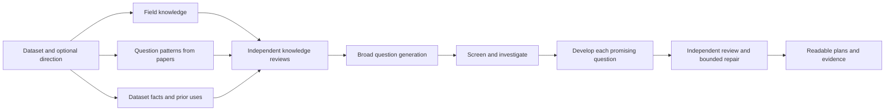

# Maiwen

**Find worthwhile research questions your dataset can answer.**

Maiwen is a scientific question-development plugin for Codex and Claude Code. Give it a dataset, with a broad direction or no direction at all. It studies the field, learns ways of asking questions from good papers, inspects the actual data, and develops promising ideas into precise research plans with independent review.

[Install](QUICKSTART.md) · [See an example](examples/README.md) · [Understand the method](WORKFLOW.md)

> **Research preview · 0.2.0-beta.1 candidate.** This package is prepared for review; publication is pending. It develops research plans. Scientific judgment and the evidence behind each question remain essential.

## Start with the data

Install the complete plugin from a downloaded checkout using the [quickstart](QUICKSTART.md), then ask:

> Use Maiwen to find worthwhile questions this dataset can answer: `/absolute/data/path`. I have no seed question. Start by checking the inputs and agreeing on a research budget.

A direction, local PDFs, known prior work and an existing question-pattern bank are optional. Maiwen identifies what it can inspect itself and asks for consequential facts only you can supply. You can steer, pause or resume the work in the host's ordinary conversation.

## What you get

A readable dossier explains **what each question asks, why an answer matters, what the data support, and how to perform the proposed computation**. It links to the field account, detailed paper notes, data checks, candidate history and independent reviews. All saved research documents are English.

The [IBL example](examples/ibl-conditional-question.md) shows a real conditional lead and the measurement problem that prevented a stronger recommendation. The [small walkthrough](examples/walkthrough.md) illustrates how to read a question, its calculation and its stopping point.

## How the work fits together

The host supplies the model, tools, permissions and native subagents. Maiwen supplies scientific responsibilities, evidence standards and readable handoffs. There is no separate model service to configure. Better host capabilities can support the work directly; scientific quality still needs to be checked.

The complete workflow uses independent contexts for knowledge review and question planning. It permits a small additional generation batch when failures reveal a new opportunity, within the original budget. It can also stop. There is no quota of successful questions. See [the complete workflow](WORKFLOW.md) and [how to read the results](docs/READING-RESULTS.md).

## Four skills, one complete workflow

| Skill | Use it for |
| --- | --- |
| `discover` | The coordinated question-development workflow |
| `learn-patterns` | A portable, reviewed library of question-forming and hypothesis-forming moves from papers |
| `dataset-card` | Broad data reconnaissance and targeted measurement/coverage checks |
| `prior-use` | What these data have already answered, and the closest conceptual precedents |

You can bring your own PDFs or let the host find studies. A reviewed pattern bank can travel between projects. It complements current field research and dataset investigation; it does not replace either.

## Status and scope

Local Codex and Claude Code with native subagents are the intended hosts. Read the [validation and limitations](docs/LIMITATIONS.md) for the tested scope. Account limits, model access, local permissions and available literature tools belong to your host. This package does not provide extra inference credits.

Planning can include authorized structure, coverage, marginal distributions and synthetic checks. Running a candidate's real target analysis is a separate request. A conditional plan is useful work, but it is not an established finding or a promise of a publishable result.

## From Maieusis to Maiwen

**[Maieusis](https://github.com/BeibaiDraco/maieusis) is Maiwen's predecessor.** It developed the central idea of learning how strong papers form questions and testing those questions against real datasets. Maiwen carries that scientific purpose into a portable host-native workflow. The history and design choices are explained in [Method and lineage](docs/METHOD.md).

[Support](SUPPORT.md) · [Data and privacy](PRIVACY.md) · [Citation](CITATION.cff) · [License](LICENSE)
