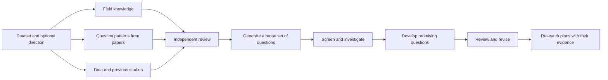

# Maiwen

**Find worthwhile research questions your dataset can answer.**

You have a dataset. What would be worth learning from it, and which questions can its measurements actually resolve?

Maiwen helps develop those questions inside Codex or Claude Code. It studies the scientific field, learns from how strong papers asked their questions, and examines the data and their previous uses. Separate agents propose ideas, investigate promising comparisons and review the resulting research plans. You can start with a broad interest or with no question in mind.

[Install](QUICKSTART.md) · [Read an example](examples/README.md) · [Explore the workflow](WORKFLOW.md)

> **Research preview · 0.2.0-beta.2.** [Get started](QUICKSTART.md) · [Validation and limitations](docs/LIMITATIONS.md)

## Start with your data

Install the plugin using the [quickstart](QUICKSTART.md), then ask:

> Use Maiwen to find worthwhile questions this dataset can answer: `/absolute/data/path`. I have no seed question. Start by checking the inputs and agreeing on a research budget.

You can also supply local papers, known prior work, a direction or an existing library of question patterns. Maiwen first reads the available material, then asks about missing facts that need your knowledge. You can steer, pause or resume the work in the same conversation.

## Read the scientific argument

For each developed question, the final report explains what is unknown, why an answer matters, what earlier studies established, and how the proposed computation would answer it. It describes the measurements, assumptions and possible interpretations in enough detail for a colleague to assess the study.

The report links to the field overview, paper notes, data checks, candidate history and reviews. You can inspect what informed an idea and why it was kept, changed or rejected. All saved research documents are in English.

The [IBL example](examples/ibl-conditional-question.md) explains a real question about neural timescales: why it matters, how paired recordings could answer it, what different results would mean, and which measurement choices still need work. The [measurement walkthrough](examples/walkthrough.md) shows how a broad idea becomes a precise comparison and a proposed calculation.

## How Maiwen develops a question

Ideas can come from experiments, theory, connections across fields or an unusual feature of the data. Planning then asks whether the proposed comparison would teach us something useful and whether the available observations support it. When an idea changes substantially, its scientific contribution and data requirements are checked again.

Review and revision have a finite budget. If the first set cannot advance, Maiwen may explore one further set of ideas informed by those failures. The report can contain supported recommendations, conditional directions or reasons to stop; the number follows the evidence. See the [complete workflow](WORKFLOW.md) and [guide to reading results](docs/READING-RESULTS.md).

## Four skills, one workflow

| Skill | What it does |
| --- | --- |
| `discover` | Coordinates the full process from preparation to reviewed research plans |
| `learn-patterns` | Builds a reusable library of ways to form questions and hypotheses from papers |
| `dataset-card` | Examines what the data measure, how they were collected and which comparisons they support |
| `prior-use` | Explains previous uses of the data and finds the closest work on a proposed question |

A pattern library can travel between projects. Bring your own PDFs or let the agent find instructive studies. For each new dataset, Maiwen combines that library with current field knowledge and direct investigation of the data.

## Use your existing research tools

Codex or Claude Code supplies the model, tools, permissions and separate agent sessions. Maiwen supplies the research instructions and document structure. It uses your existing host account; there is no separate model service to configure. As the host's reasoning, search and coding capabilities improve, Maiwen can use them directly.

The workflow develops research plans. Planning includes permitted data inspection and synthetic checks; running the proposed scientific analysis requires a separate request. The [validation record](docs/LIMITATIONS.md) explains what has been tried so far and what remains uncertain.

## From Maieusis to Maiwen

**[Maieusis](https://github.com/BeibaiDraco/maieusis) is Maiwen's predecessor.** It introduced the central idea of learning how successful papers form questions and developing those questions against real datasets. Maiwen carries that purpose into a plugin that works within Codex and Claude Code. Read [Method and lineage](docs/METHOD.md) for the scientific rationale and design history.

[Support](SUPPORT.md) · [Data and privacy](PRIVACY.md) · [Citation](CITATION.cff) · [License](LICENSE)
