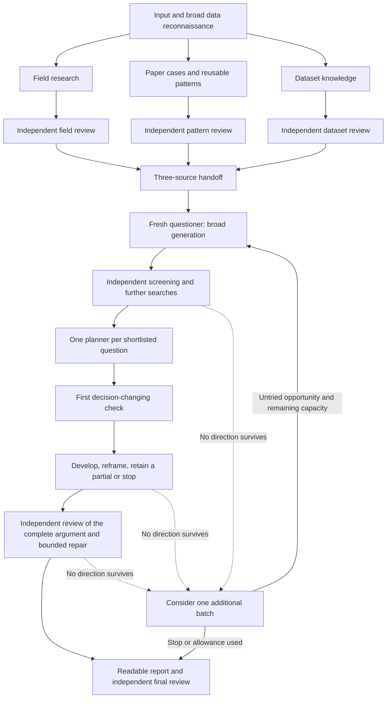

# Maiwen's research workflow

Maiwen develops scientifically worthwhile questions that the available dataset can answer. Start with a data location; a direction, papers and an existing question-pattern bank are optional. Your coding-agent host runs the work using its own tools, model, permissions and account.

All saved intermediate and final research artifacts are **English**. You can converse with the host in another language. Source documents and raw data retain their original form; their research explanations are English.

## The sequence

The main host assigns roles, collects results and manages the budget. Independent tasks may run concurrently; a smaller concurrency limit simply queues them. The workflow uses native subagents with task instructions, not an additional model service or research-state engine. Installing a plugin alone does not launch research: invoke a skill in a normal host session.

## What the questioner receives

| Knowledge | What it explains | Independent scrutiny |
|---|---|---|
| Field account | Core concepts, important experiments, theories, contested interpretations, open problems and useful links across subfields | Source fidelity, missing perspectives and whether proposed observable predictions follow from theory |
| Question-pattern bank | How excellent studies turned a scientific tension and data conditions into a revealing question; reusable moves, cases and failure conditions | Reconstruction of original comparisons, validity of cross-case generalization and failed transfers |
| Dataset account | Actual inspected data; collection papers and public documentation; studies using these observations and what they established | Identity, measurement meaning, design/coverage and the actual content of previous research |

The questioner reads the substantive accounts and important paper notes, not only a short table. `questioner-input.md` makes these materials easy to find and states current unknowns. Initial candidate answers and review preferences do not seed a fresh discovery; early ideas from preparation go to the screener instead; verified facts, constraints and prior outcome exposure still travel with it.

Preparation is complete enough when the separate reviews support informed generation, with local limitations explicit. For each stream, the handoff states whether a completed review covers its current version. A material rewrite still awaiting recheck remains preparation work; when the budget expires, the host delivers that useful partial rather than sending provisional versions to formal generation. It need not exhaust a discipline or prove each future question feasible. A missing whole stream is a visible preparation gap. Earlier ideas are saved in `early-ideas.md` without becoming the only topics investigated; the screener assesses them alongside generated candidates.

## A portable bank of ways to ask questions

Use `learn-patterns` independently to build, update or reuse a bank, even without a target dataset. Supply papers if you have them, or a field from which the host can find useful studies. During `discover`, the data's broad scientific context provides that starting point automatically.

A bank includes a readable `question-patterns.md`, detailed cases, source index and independent review. Each pattern explains when it helps, how it changes a question, why its comparison adds knowledge, essential conditions and failure cases. The same guide distinguishes forming a worthwhile question from constructing a hypothesis and its observable predictions; a case may support either or both. These moves can interact, and descriptive or predictive questions do not require a mechanism hypothesis. The reviewer tries the guide in a different stated setting, checks sources and challenges consequential inferences even when their listed conditions hold. Distinguish a single-case inspiration from support across independent studies. A named pattern is not proof of novelty or feasibility.

Carry the library to another project. Reuse checked unchanged material after verifying review coverage and present applicability; investigate changed claims or contradictions rather than rebuilding everything. The project's `knowledge/pattern-selection.md` records the version used and how useful moves relate to its data. Private libraries are not automatically included in the public plugin.

## From candidates to plans

The questioner generates scientifically different opportunities. The screener reads them, the early ideas and their inputs and can search new sources, identifying contribution, duplicates, closest prior work and obvious barriers. The number of questions follows scientific promise and the available planning/review budget; there is no quota of successful recommendations. An idea deferred for capacity is not scientifically rejected.

If screening or planning leaves no direction that can advance, the coordinator first checks queued alternatives, then may commission one small additional batch informed by the failures. It reuses current knowledge and follows the same screening/planning/review under the original total budget. Old arguments retain their consumed cycles. The host may stop immediately when evidence, opportunity or time is insufficient. See the [bounded return](skills/discover/references/coordination.md#one-evidence-guided-return-to-generation).

Each shortlisted question gets its own planning context and directory. The planner first performs the affordable source, support, measurement or logical check most likely to change further investment. That result determines whether to develop an ordered computation, reframe, return a limited conditional sketch or stop. The coordinator can allocate remaining time to a different queued opportunity without resetting a linked argument's repair allowance. Reframing renews affected value, literature and data checks. The independent reviewer starts from the strongest scientific conclusion and its weakest unverified step, following the whole computation through selection, weighting and interpretation. It tests the actual rule and whether a colleague could implement it without inventing scientific decisions. These are tasks inside the existing roles, not additional review tiers.

Default planning includes authorized structural, coverage, marginal-distribution and suitable synthetic checks. It excludes using the candidate's real target effect or significance to select questions, full analysis and confirmation outcomes. The purpose of a calculation determines this boundary. A plan is not a result, and a working script does not prove the dataset can resolve a meaningful scientific uncertainty.

## Review that finishes

Use an initial assessment and at most two substantive repair-and-recheck cycles for each knowledge stream or linked question argument, within the total budget. Renaming, reframing or reaching final writing does not reset the allowance. Authors verify reviewer suggestions before adopting them; a replacement can be wrong too. A reviewer checks the repaired scientific claim and actual calculation, not just that an edit occurred.

The final reviewer reads the full report, final plans, NEXT and prepared summary. Preserve supported, conditional, review-pending, deferred and rejected outcomes with their reasons. At a limit, save useful partials and the smallest unresolved decision. Budget exhaustion does not prove scientific rejection or acceptance.

When native independent contexts are unavailable, the host can still prepare useful knowledge and a review handoff. It must disclose that the complete independent workflow did not run. Same-model independent contexts can catch errors but share biases; evidence and counterexamples matter more than agreement.

## Find every artifact

| File or folder | Purpose |
|---|---|
| `research/<dataset>/README.md` | Current index, responsibilities, completed work and missing handoffs |
| `brief.md` | Inputs, intent, scope, known unknowns and finite budget |
| `knowledge/field/overview.md` | Substantive field account, linked topics and paper notes |
| `knowledge/dataset/card.md` | Actual data and evidence-linked planning checks |
| `knowledge/dataset/source-report.md` | Collection papers, documentation and correspondence with local data |
| `knowledge/dataset/prior-use.md` | Previous uses and their actual scientific contributions |
| `knowledge/pattern-selection.md` | Selected library revision, useful moves and target conditions |
| `reviews/field.md`, `reviews/dataset.md` | Separate knowledge reviews and verified repairs |
| `questioner-input.md` | Explicit handoff into formal generation |
| `early-ideas.md`, `candidates.md`, optional `candidates-round-2.md`, `screening.md` | Preparation ideas, broad proposals and independent dispositions |
| `questions/<id>/development.md` | Checks, reframing and reasons for the final form |
| `questions/<id>/plan.md`, `review.md` | Reproducible proposed computation and independent review |
| `recommendations.md` | Self-contained, readable final dossier |
| `final-review.md`, `NEXT.md` | Exact-final checking, checked summary and continuation |
| `paperbanks/<collection>/` | Portable patterns, cases, source index and review, separate from one dataset |

Detailed paper notes may live under either knowledge stream and be linked from the other. One writer owns a shared note; verified corrections update its current scientific account and affected questions, with superseded claims linked as history. A distant addendum does not leave contradictory current instructions in place. Actual checks remain beside the relevant data card or question. Files organize work, not access control. The host and environment enforce permissions.

Older workspaces may use `card.md`, `field.md`, `prior_use.md` and `paperbank/` at the research root. Continue from their evidence without overwriting frozen outputs. Link the current material in the index, fill missing preparation/review and write new artifacts in English. For a specific existing question, resume its planning instead of unnecessarily regenerating a full set.

## Where the instructions live

- [discover](skills/discover/SKILL.md) is the coordinating entry; [coordination](skills/discover/references/coordination.md) specifies native assignments and handoffs.
- [learn-patterns](skills/learn-patterns/SKILL.md) builds and reuses the portable library with separate authorship and review.
- [dataset-card](skills/dataset-card/SKILL.md) and [prior-use](skills/prior-use/SKILL.md) provide data and reuse methods.
- [Knowledge review](skills/discover/references/knowledge-review.md), [screening](skills/discover/references/screening.md), [plan review](skills/discover/roles/plan-reviewer.md) and [bounded critique](skills/discover/references/critique.md) define distinct checking responsibilities.
- [Delivery](skills/discover/references/delivery.md) gives the human explanation and computational handoff, including a fictional writing example.

Use the [quickstart](QUICKSTART.md) for installation. Package checks establish relocatable resources and distribution hygiene; behavior tests check actual handoffs and independent work. Scientific value requires examining real questions and evidence, and is not established by the number of files or agents.
