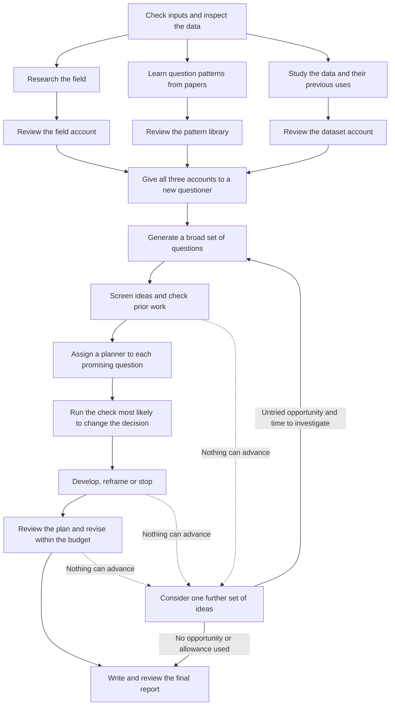

# Maiwen's research workflow

Maiwen starts with a dataset and develops questions through literature research, data inspection, planning and independent review. You may bring a direction, papers or a reusable pattern library; you can also begin with only a data location. Codex or Claude Code runs the work using its own model, tools and account.

All research documents are written in English. You can converse with the host in another language. Original source documents and raw data keep their existing form.

## The sequence

The main agent assigns tasks, collects completed work and manages time. Authors and reviewers work in separate native agent sessions. Independent tasks can run in parallel or wait for an available session. Installing the plugin makes the skills available; invoking `discover` begins the research.

## Prepare the questioner's knowledge

Three accounts give the questioner different kinds of knowledge:

| Account | What it explains | What its reviewer checks |
| --- | --- | --- |
| Field knowledge | Important concepts, experiments, theories, contested interpretations, open problems and connections across subfields | Whether the sources support the account, important perspectives are missing, and proposed tests follow from theory |
| Question-pattern library | How earlier studies turned an uncertainty into an informative question, with examples and conditions for reuse | Whether the original comparisons are reconstructed faithfully and the generalized reasoning works in another setting |
| Dataset knowledge | What the inspected data measure, how they were collected and what previous studies did with them | Whether measurements and observation units are understood, local data match the documentation, and prior contributions are described accurately |

Each author writes a substantive account with detailed notes on the papers that matter. The questioner receives these documents and sources after their independent reviews cover the current versions. A remaining uncertainty can be carried into generation if the available knowledge still supports informed questions; a missing body of knowledge is recorded as unfinished preparation.

Ideas that arise during preparation go in `early-ideas.md`. The questioner works without those suggested answers, so it can explore the prepared knowledge for itself. The screener later considers both sets of ideas.

## Learn reusable ways to ask questions

The `learn-patterns` skill can build a library from supplied papers or find instructive studies in a field. It also works independently of discovery, without a target dataset. A library contains `question-patterns.md`, detailed cases, a source index and an independent review.

Each pattern explains the uncertainty it helps address, the change it makes to a question, the comparison that could be informative and the conditions needed for that comparison. It includes a worked adaptation and a case where the reasoning fails. The guide distinguishes asking a question from proposing a hypothesis and deriving predictions, while showing how the two can develop together.

The reviewer tries the guide in another setting and checks it against the original studies. Evidence from one paper is identified as such; a generalization across independent studies explains what they share. To reuse a library, the next project checks the reviewed version and its applicability, then records the selected patterns in `knowledge/pattern-selection.md`. Changed claims receive further scrutiny; unchanged, supported material can be reused.

## Turn ideas into research plans

The questioner explores scientifically different opportunities. A separate screener reads the proposals, early ideas and their sources, searches further where needed, and explains which questions merit development. It identifies the closest prior work, duplicates and obvious data barriers. The number investigated depends on scientific promise and the time available for planning and review. Ideas left for lack of time are recorded separately from scientific rejections.

Each shortlisted question gets its own planner and directory. The planner begins with the affordable check most likely to change the decision to pursue it. This could resolve a source claim, a measurement definition, joint data coverage or a logical implication. The result determines whether to develop the calculation, reframe the question, preserve a conditional direction or stop. Remaining time can then go to another promising idea.

A developed plan follows the computation from eligible observations through transformations, weights, estimation and uncertainty to interpretation. When a reframe changes the scientific question, the planner revisits its contribution, prior work and data requirements. The independent reviewer assesses that revised contribution and checks the complete calculation, including any selection or combination of comparisons. The plan should specify the scientific decisions a colleague would need to implement it.

Planning permits authorized structural, coverage, marginal-distribution and suitable synthetic checks. Testing a candidate's real target effect, selecting questions by significance, running a full analysis or reading confirmation outcomes falls outside that scope. The purpose of a calculation determines which kind of work it is.

## Review, revise and finish

Each knowledge account or linked question argument receives an initial assessment and at most two substantive repair-and-recheck cycles, within the total budget. Authors verify the reviewer's objection and proposed remedy, then revise the argument. The reviewer checks the actual replacement. Renaming, reframing or moving to final writing preserves the cycles already used.

If no question can advance, the coordinator first considers ideas already waiting. It may then commission one further small generation batch when the prepared knowledge suggests a different opportunity and enough time remains to investigate it. The new batch uses the same screening, planning and review process; reframed old arguments retain their used cycles. The [coordination instructions](skills/discover/references/coordination.md#one-evidence-guided-return-to-generation) explain how to continue this attempt after an interruption.

The final reviewer reads the finished report, plans, `NEXT.md` and prepared summary. Their claims and computational meaning must agree. At the budget limit, the report preserves useful work and identifies what remains unresolved. It distinguishes supported recommendations, conditional directions, pending reviews, ideas deferred for time and rejected proposals.

If separate agent contexts are unavailable, the host can prepare the knowledge and specify the independent reviews still needed. It records this as a partial workflow.

## Find every artifact

| File or folder | Purpose |
|---|---|
| `research/<dataset>/README.md` | Current index, responsibilities, completed work and missing handoffs |
| `brief.md` | Inputs, intent, scope, known unknowns and finite budget |
| `knowledge/field/overview.md` | Substantive field account, linked topics and paper notes |
| `knowledge/dataset/card.md` | Actual data and evidence-linked planning checks |
| `knowledge/dataset/source-report.md` | Collection papers, documentation and correspondence with local data |
| `knowledge/dataset/prior-use.md` | Previous uses and their actual scientific contributions |
| `knowledge/pattern-selection.md` | Selected library revision, useful moves and target conditions |
| `reviews/field.md`, `reviews/dataset.md` | Separate knowledge reviews and verified repairs |
| `questioner-input.md` | Explicit handoff into formal generation |
| `early-ideas.md`, `candidates.md`, optional `candidates-round-2.md`, `screening.md` | Preparation ideas, broad proposals and independent dispositions |
| `questions/<id>/development.md` | Checks, reframing and reasons for the final form |
| `questions/<id>/plan.md`, `review.md` | Reproducible proposed computation and independent review |
| `recommendations.md` | Self-contained, readable final dossier |
| `final-review.md`, `NEXT.md` | Exact-final checking, checked summary and continuation |
| `paperbanks/<collection>/` | Portable patterns, cases, source index and review, separate from one dataset |

Detailed paper notes can be linked from several accounts. One author maintains each shared note. A verified correction updates the current explanation and any affected questions, while preserving earlier versions as history. Local scripts and compact check outputs stay beside the data card or question they inform.

Older projects may use `card.md`, `field.md`, `prior_use.md` and `paperbank/` at the research root. The coordinator links those records from the current index, preserves frozen outputs and fills missing preparation or review. Continuing a particular question resumes its unresolved work.

## Where the instructions live

- [discover](skills/discover/SKILL.md) is the coordinating entry; [coordination](skills/discover/references/coordination.md) specifies native assignments and handoffs.
- [learn-patterns](skills/learn-patterns/SKILL.md) builds and reuses the portable library with separate authorship and review.
- [dataset-card](skills/dataset-card/SKILL.md) and [prior-use](skills/prior-use/SKILL.md) provide data and reuse methods.
- [Knowledge review](skills/discover/references/knowledge-review.md), [screening](skills/discover/references/screening.md), [plan review](skills/discover/roles/plan-reviewer.md) and [bounded critique](skills/discover/references/critique.md) define distinct checking responsibilities.
- [Delivery](skills/discover/references/delivery.md) gives the human explanation and computational handoff, including a fictional writing example.

The [quickstart](QUICKSTART.md) covers installation. The [validation record](docs/LIMITATIONS.md) describes package checks, observed workflow behavior and scientific development trials.
